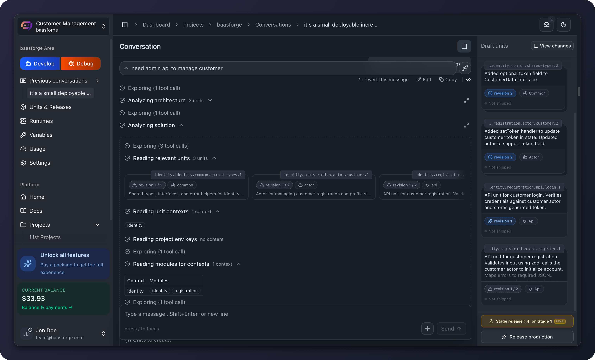

<p align="center">
  
</p>
<h1 align="center">BaaSForge Backend</h1>
<p align="center"><strong>Describe your backend in plain language. Ship APIs, workflows, and queue workers.</strong></p>
<p align="center">For developers and small teams building with BaaSForge.</p>
<p align="center">
  <a href="#local-quick-start">Get started</a> ·
  <a href="#documentation">Documentation</a> ·
  <a href="#contributing">Contribute</a>
</p>

[](LICENSE)
[](https://github.com/BaaSForge/baasforge-backend-actix)
[](https://github.com/BaaSForge/baasforge-backend-actix/issues)
[](CONTRIBUTING.md)
[](#community-and-support)


<p align="center">
  <a href="docs/assets/backend-conversation.png">
    
  </a>
</p>

A plain-language request alongside the analysis and draft units in the BaaSForge dashboard.

## Contents

- [Why BaaSForge?](#why-baasforge)
- [Ecosystem](#ecosystem)
- [Services](#services)
- [Local quick start](#local-quick-start)
- [Runtime connection](#runtime-connection)
- [Production](#production)
- [Development checks](#development-checks)
- [Historical name](#historical-name)
- [Documentation](#documentation)
- [Roadmap](#roadmap)
- [Contributing](#contributing)
- [Community and support](#community-and-support)
- [Code of Conduct](#code-of-conduct)
- [Security](#security)
- [License](#license)

## Why BaaSForge?

BaaSForge is for developers and small teams who want to describe a backend in plain language and ship APIs, workflows, and queue workers to production.

Start here for the BaaSForge ecosystem. For self-hosting, follow the [production guide](docs/production.md) and [configuration reference](docs/configuration.md) after the local setup.

Actix backend for the BaaSForge platform.

This repository contains the HTTP API, WebSocket server, chat worker, technical
review worker, and platform-cost jobs. It uses PostgreSQL, RabbitMQ, Redis, and
NATS JetStream.

The backend also requires the separate
[BaaSForge runtime](https://github.com/BaaSForge/baasforge-runtime-actix).
The two repositories connect through HTTP and NATS. They do not use a shared
Rust dependency.

## Ecosystem

The [backend repository](https://github.com/BaaSForge/baasforge-backend-actix) is the main entry point. Use the runtime and frontend repositories for their respective parts of the system.

| Repository | Start here |
| --- | --- |
| [Backend](https://github.com/BaaSForge/baasforge-backend-actix) | Main entry point and control plane |
| [Runtime](https://github.com/BaaSForge/baasforge-runtime-actix) | Execution plane |
| [Frontend](https://github.com/BaaSForge/baasforge-frontend-vite) | Dashboard, public pages, and documentation |

## Services

| Service | Purpose |
| --- | --- |
| BaaSForge API (`baal-backend-actix` legacy binary) | REST API, WebSocket endpoint, authentication, projects, releases, payments, and runtime proxy |
| `chat_worker` | Processes chat and LLM work from RabbitMQ |
| `unit_technical_reviewer` | Reviews generated TypeScript units from RabbitMQ |
| `platform_cost_calculate_scheduler` | Adds cost-calculation work to RabbitMQ |
| `platform_cost_calculate_consumer` | Processes cost and usage work |

See [Architecture](docs/architecture.md) for the full data flow.

## Local quick start

Requirements:

- Rust 1.93 or a compatible newer toolchain
- Docker with Docker Compose
- Node.js and npm
- PostgreSQL client libraries
- Diesel CLI 2.3.5 with the PostgreSQL feature
- `curl`

Install the Rust tools:

```bash
rustup component add clippy rustfmt
cargo install diesel_cli --version 2.3.5 --no-default-features --features postgres
```

Install the TypeScript dependencies:

```bash
cd src/tsgo
npm ci
cd ../..
```

Review `.env`. Put machine-specific or private development values in
`.env.local`. Then start the local infrastructure:

```bash
docker compose up -d
```

> **IMPORTANT — FRESH DEVELOPMENT DATABASE**
>
> **Do this before the first `./migration-up.sh`.**
>
> ```sql
> CREATE TABLE app_settings (key TEXT PRIMARY KEY, value TEXT);
> INSERT INTO app_settings (key, value) VALUES ('env', 'development');
> ```
>
> **If you run migrations first, clear and recreate the development database.
> Then create this table and run the migrations again.**

Run migrations and create the RabbitMQ topology:

```bash
./migration-up.sh
./queue_setup_http.sh
```

Start one API process:

```bash
./dev.sh 1101
```

Or start the scaled development set:

```bash
./dev-scaled.sh
```

The scaled set starts two API processes and two instances of each long-running
worker. Nginx listens on `http://localhost:1100` and balances API traffic
between ports `1101` and `1102`.

Current development scripts do not enable hot reload. Restart a process after
you change its code.

For all setup steps and individual service commands, see
[Local development](docs/local-development.md).

## Runtime connection

Run
[baasforge-runtime-actix](https://github.com/BaaSForge/baasforge-runtime-actix)
as a separate project.

For local development:

- Set `BASE_RUNTIME_ENDPOINT` to the runtime HTTP URL, normally
`http://localhost:1500`.
- Set the backend and runtime to the same NATS server.
- Keep the release and environment stream, subject, and consumer names equal in
both repositories.
- Keep the usage stream and subject names equal.
- Use the same private API key on both sides.

This guide only explains the connection. Configure and start the runtime with
the instructions in its repository.

## Production

Production uses five Docker images. `compose.prod.services.yml` starts the
supporting PostgreSQL, RabbitMQ, Redis, NATS, and Jaeger services. It does not
start the application containers or the runtime repository.

**All credentials in this repository are development defaults. Replace every
database, RabbitMQ, NATS, API, OAuth, payment, and token secret before
production. Do not publish production secrets in Git or Docker images.**

The included GitHub workflow builds images, runs forward migrations, and
deploys application containers for matching production or staging tags. It
does not provision the server, queues, nginx, TLS certificates, or the runtime.

See [Production and self-hosting](docs/production.md) and
[Configuration](docs/configuration.md).

## Development checks

```bash
cargo fmt --all -- --check
CARGO_BUILD_RUSTC_WRAPPER= cargo clippy --all-targets
./test.sh
```

The repository has no Prettier command. The current deployment workflow does
not run format, Clippy, or test checks. See [Contributing](CONTRIBUTING.md).

## Historical name

`baal` was the old platform name. The current name is `baasforge`.

Some internal and infrastructure identifiers still use `baal`, including the
Rust package and binary, database name and user, container names, trace tags,
and inline markup. Treat these as legacy compatibility names. A reference to
`baal` in this repository usually refers to BaaSForge; it does not refer to a
separate service.

Do not rename a legacy identifier without checking all integrations,
migrations, deployment files, stored data, and the runtime repository.

## Documentation

- [Architecture](docs/architecture.md)
- [Local development](docs/local-development.md)
- [Production and self-hosting](docs/production.md)
- [Configuration](docs/configuration.md)
- [Chat queue](docs/chat-queue.md)
- [Chat agents](docs/chat-agents.md)
- [Release model](docs/releases.md)
- [Unit technical reviewer](docs/unit-technical-reviewer.md)
- [Type checker](docs/type-checker.md)
- [Type extractor](docs/type-extractor.md)

## Roadmap

Where BaaSForge is heading:

- [ ] Performance & runtime durability
- [ ] Stream processing and WebSocket / realtime units
- [ ] Storage pattern units
- [ ] Monitoring, alerting, and collaboration

<details>
<summary><strong>Explore more planned capabilities</strong></summary>

- Event and schedule triggers
- SDK convenience helpers
- Files and search behaviors
- Unit marketplace
- Third-party integrations

</details>

> These plans are directional. Timing and order may change.

**[Explore the full roadmap →](https://baasforge.com/docs/about/future-plans)**

See [Units](https://baasforge.com/docs/platform/units) for what is available now.

## Contributing

Read [CONTRIBUTING.md](CONTRIBUTING.md) before opening a pull request.
Documentation fixes, reproducible bug reports, and focused improvements are welcome.
Browse [open issues](https://github.com/BaaSForge/baasforge-backend-actix/issues), or explain a proposed change before starting substantial work.

## Community and support

- [Report a bug or suggest an improvement](https://github.com/BaaSForge/baasforge-backend-actix/issues).
- Include reproduction steps and the relevant repository when asking for help.
- If BaaSForge is useful to you, consider starring the repository or sharing what you built.

## Code of Conduct

Read our [Code of Conduct](CODE_OF_CONDUCT.md) for community standards and private reporting instructions.

## Security

Read our [Security Policy](SECURITY.md) to report a vulnerability privately and understand the scope of security maintenance.

## License

Licensed under the [Apache License 2.0](LICENSE).
