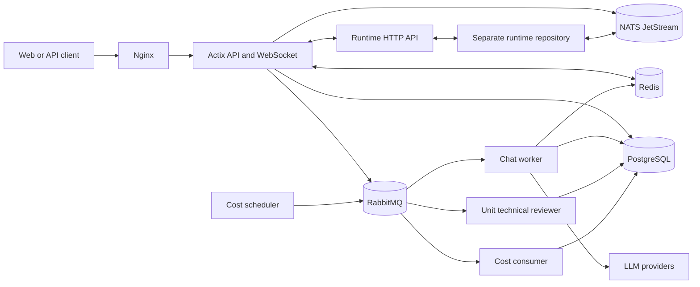

# Architecture

The repository builds one API and four background binaries. The processes
share PostgreSQL, RabbitMQ, Redis, and NATS.

## API and WebSocket process

The BaaSForge API starts from `src/main.rs` and listens on `BIND_HOST` and
`PORT`. Its package and binary still use the legacy name
`baal-backend-actix`.

Its main route areas are:

- `/api/v1/auth`: OAuth, tokens, and the current user.
- `/api/v1/payment`: packages, Stripe payments, and balances.
- `/api/v1/ws`: authenticated WebSocket connections.
- `/api/v1/private/*`: authenticated proxy requests to the runtime.
- `/api/v1/platform`: projects, units, releases, runtimes, chat, usage, and
  observability.

The API stores durable data in PostgreSQL. It publishes work to RabbitMQ. Redis
provides WebSocket fan-out and short-lived chat stop state.

## RabbitMQ workers

`queue_setup_http.sh` creates all exchanges, queues, retry queues, dead-letter
queues, and bindings.

### Chat

The API publishes to `chat_session_exchange`. `chat_worker` consumes
`chat_session_work_queue`.

The worker loads chat state, calls the configured LLM provider, runs tools, and
writes results. It publishes user updates through Redis for delivery over the
WebSocket connection. Tool calls and later LLM continuations are separate
RabbitMQ messages.

See [Chat queue](chat-queue.md) and [Chat agents](chat-agents.md).

### Unit technical review

The API and chat tools publish to `unit_reviewer_exchange`.
`unit_technical_reviewer` consumes `unit_reviewer_work_queue`. It parses and
checks generated TypeScript with the feature-gated Oxc and tsgo components.

See [Unit technical reviewer](unit-technical-reviewer.md) and
[Type checker](type-checker.md).

### Platform cost calculation

`platform_cost_calculate_scheduler` selects usage windows and publishes work to
`platform_cost_calculate_exchange`. It is a one-shot process.

`platform_cost_calculate_consumer` consumes
`platform_cost_calculate_work_queue` and updates cost data in PostgreSQL.
Production runs the scheduler from cron every three minutes.

## Runtime repository

[baasforge-runtime-actix](https://github.com/BaaSForge/baasforge-runtime-actix)
is a separate application. It is not a Cargo dependency and is not built by
this repository.

The applications connect in two ways:

1. HTTP
   - `BASE_RUNTIME_ENDPOINT` is the public runtime URL.
   - `/api/v1/private/*` proxies private runtime calls.
   - `RUNTIME_PRIVATE_API_KEY` authenticates private calls.
2. NATS JetStream
   - Release subjects notify the runtime about deploy and detach operations.
   - Environment subjects invalidate runtime environment caches.
   - Usage subjects carry metering batches.

Both applications must use the same NATS URL, subjects, stream names, consumer
names, and private API key. Configure the runtime itself with the instructions
in its repository.

The normal local runtime endpoint is `http://localhost:1500`. The included
production nginx configuration expects the runtime on `127.0.0.1:1501`.

## Infrastructure

### Local

`compose.yml` starts:

- PostgreSQL on host port `5632`.
- RabbitMQ on `5673`, with management UI on `15673`.
- Redis on `6379`.
- Nginx on `1100`.

The local nginx process uses least-connections balancing between API ports
`1101` and `1102`. It also forwards WebSocket upgrade headers.

NATS, Jaeger, and the runtime are not in the local Compose file.

### Production support services

`compose.prod.services.yml` starts PostgreSQL, RabbitMQ, Redis, NATS JetStream,
and Jaeger. It does not start the API, workers, nginx, or runtime.

The application Dockerfiles build separate images for:

- API
- Chat worker
- Unit technical reviewer
- Platform-cost scheduler
- Platform-cost consumer

See [Production and self-hosting](production.md).

## Data ownership

PostgreSQL stores users, tokens, projects, units, releases, runtimes, runtime
environment variables, chat sessions and messages, payments, and usage
entries.

RabbitMQ stores pending and failed work. Redis stores transient coordination
data. NATS carries runtime control and usage events. Jaeger stores and serves
trace data outside this application.
