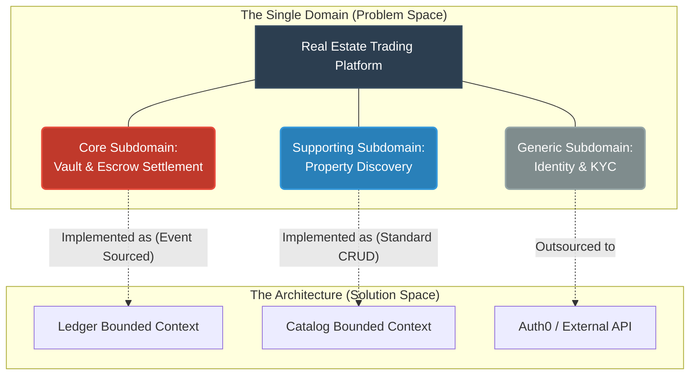
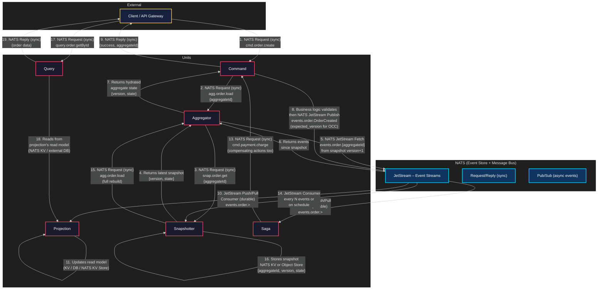

### How to distinguish Domain vs. Subdomain in practice
One software equals one Domain, but that Domain is a collection of Subdomains.

Think of it like a Tree:

- The Root (Domain: problem space): The high-level business (Real Estate).
- The Branches (Subdomains: problem space): The logical divisions of the business (Finance, Search, Auth).
- The Leaves (Bounded Contexts: solution space): The actual microservices or code modules you write to solve the problems identified by the branches.

### Bounded Contexts own the Event Store
In Event Sourcing, the Event Store acts as the single source of truth. **An Event Store strictly belongs to one Bounded Context**. * Events like `FundsLockedInVault` or `EscrowReleased` are defined by the Ubiquitous Language of that specific context.

- Other Bounded Contexts should not read directly from this Event Store. If the "Listing Context" needs to know an escrow closed, the "Ledger Context" publishes an Integration Event over a message broker (like NATS or RabbitMQ), rather than sharing its internal Domain Events.

### Communications between units

