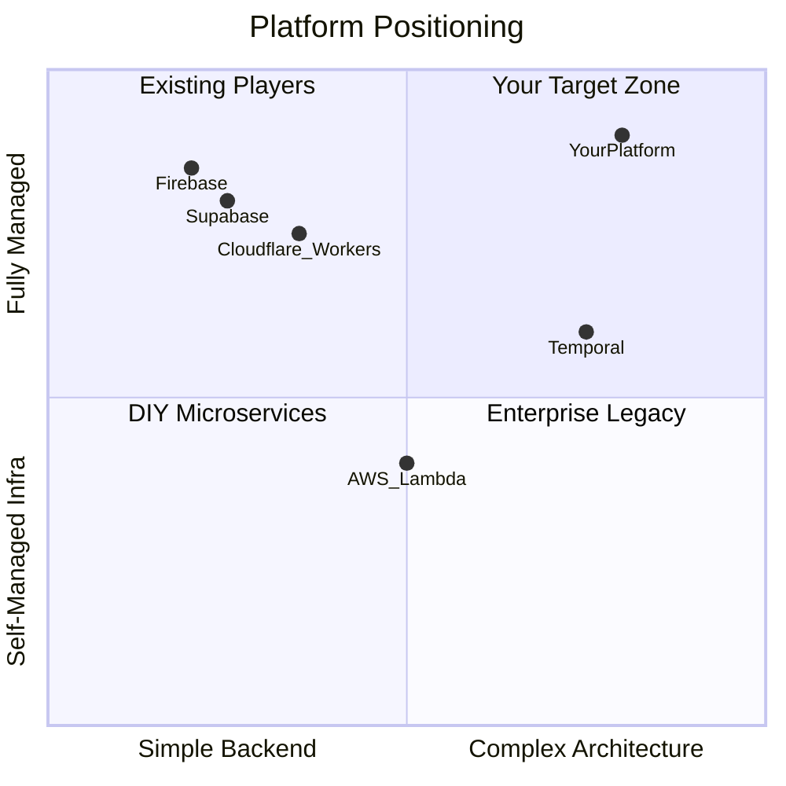

# Bold Feature Strategy: Architecture-as-a-Service

## The Core Thesis

Supabase and Firebase answer: **"How do I get a backend running fast?"**
Your platform should answer: **"How do I build a *serious* distributed backend without an infrastructure team?"**

The research shows:

- Temporal.io hit a **$5B valuation** proving demand for durable workflows
- Cloudflare Durable Objects proved demand for **stateful serverless**
- Developers spend **30-40% of their time on infrastructure** instead of product code
- **No platform** offers architectural patterns (event sourcing, sagas, actors) as first-class serverless primitives
- AI agent orchestration is exploding and needs durable execution

Your unique advantage is the combination of **bounded contexts + typed units + AI agent generation**. This means you can offer entire *architectural patterns* as composable primitives. The AI agent doesn't just generate functions — it scaffolds entire domain architectures.

---

## TIER 1 — Killer Unit Types (The Differentiators)

These are the features that **do not exist** in Supabase or Firebase and are extremely hard for developers to build themselves. Each one alone justifies a user choosing your platform.

### 1. Durable Workflow Unit

**What it is:** A unit that defines multi-step, long-running workflows that **survive crashes, restarts, and deployments**. Each step is individually retriable with configurable backoff. Workflows can run for seconds or days.

**Why it's bold:** Temporal.io is a $5B company solving exactly this. Inngest and Trigger.dev raised significant funding for simpler versions. Neither Supabase nor Firebase offers anything close. You would bake Temporal-grade durability into a unit type.

**What the developer writes:**

```typescript
// Unit type: "workflow"
export default workflow("order-fulfillment", async (ctx, order: Order) => {
  const payment = await ctx.step("charge-payment", () => 
    sdk.call("payments.charge", order)
  );
  
  const inventory = await ctx.step("reserve-inventory", () => 
    sdk.call("warehouse.reserve", order.items)
  );
  
  // Wait up to 48 hours for supplier confirmation
  const confirmation = await ctx.waitForEvent("supplier.confirmed", {
    timeout: "48h",
    filter: { orderId: order.id }
  });
  
  if (!confirmation) {
    // Compensate: refund payment, release inventory
    await ctx.compensate();
  }
  
  await ctx.step("ship", () => sdk.call("shipping.dispatch", order));
});
```

**The platform handles:** Step-level persistence, automatic retries, timeout tracking, crash recovery mid-workflow, compensation (rollback) logic, parallel step execution, and observability of each step's status.

**Target users:** E-commerce (order flows), fintech (payment processing), healthcare (compliance pipelines), AI agent orchestration (multi-step reasoning chains).

---

### 2. Stateful Actor Unit

**What it is:** A unit that maintains **persistent, isolated state** between invocations. Each instance is identified by a unique ID and processes messages sequentially (no race conditions). Think Cloudflare Durable Objects meets Microsoft Orleans virtual actors.

**Why it's bold:** Cloudflare is the *only* platform offering something similar, and it's locked into their ecosystem. Neither Supabase nor Firebase has stateful compute. This unlocks an entire category of applications that are otherwise impossible on serverless.

**What the developer writes:**

```typescript
// Unit type: "actor"
export default actor("shopping-cart", {
  state: { items: [], total: 0 } as CartState,

  handlers: {
    addItem(ctx, item: CartItem) {
      ctx.state.items.push(item);
      ctx.state.total += item.price;
      // State is automatically persisted after each handler
    },

    checkout(ctx) {
      const order = { items: ctx.state.items, total: ctx.state.total };
      sdk.emit("order.created", order);
      ctx.state = { items: [], total: 0 }; // Reset
      return order;
    },

    // Actor can schedule its own future work
    async expire(ctx) {
      ctx.alarm("abandon-check", { delay: "30m" });
    }
  },

  onAlarm(ctx, name) {
    if (name === "abandon-check" && ctx.state.items.length > 0) {
      sdk.emit("cart.abandoned", { cartId: ctx.id, items: ctx.state.items });
    }
  }
});
```

**The platform handles:** State persistence, single-threaded execution per actor ID (no locks needed), automatic activation/deactivation, millions of concurrent actor instances, alarm scheduling, and location-transparent addressing.

**Target users:** Real-time apps (chat rooms, collaborative editing), gaming (player sessions), IoT (device twins), e-commerce (carts, user sessions), rate limiters.

---

### 3. Event Sourcing Units (Command + Event + Projection)

**What it is:** A set of three complementary unit types that implement the **Event Sourcing / CQRS pattern** as a first-class platform feature. Instead of mutating state directly, every change is stored as an immutable event. The platform manages the event store.

**Why it's bold:** Event sourcing is one of the most powerful architectural patterns for auditability, debugging, and temporal queries — but it's notoriously hard to implement. No serverless platform offers this as a primitive. You would be the first.

**Three unit sub-types:**

```typescript
// Unit type: "command" — validates and produces events
export default command("account.deposit", async (ctx, cmd: DepositCommand) => {
  const account = await ctx.loadAggregate("account", cmd.accountId);
  
  if (account.state.frozen) {
    throw new DomainError("Account is frozen");
  }
  
  ctx.emit("account.deposited", {
    accountId: cmd.accountId,
    amount: cmd.amount,
    balance: account.state.balance + cmd.amount
  });
});

// Unit type: "event-handler" — reacts to events (side effects)
export default eventHandler("account.deposited", async (ctx, event) => {
  if (event.data.amount > 10000) {
    sdk.call("compliance.flagTransaction", event.data);
  }
  sdk.call("notifications.send", {
    userId: event.data.accountId,
    message: `Deposited $${event.data.amount}`
  });
});

// Unit type: "projection" — builds optimized read models
export default projection("account-balance-view", {
  events: ["account.deposited", "account.withdrawn"],
  
  apply(state, event) {
    switch (event.type) {
      case "account.deposited":
        return { ...state, balance: state.balance + event.data.amount };
      case "account.withdrawn":
        return { ...state, balance: state.balance - event.data.amount };
    }
  }
});
```

**The platform handles:** Event store (append-only log), aggregate loading/snapshotting, event ordering guarantees, projection rebuilds, event replay for debugging ("time travel"), and schema evolution.

**Target users:** Fintech (transaction audit trails), healthcare (patient record history), legal/compliance (immutable records), any domain where "what happened and when" matters.

---

### 4. Saga / Distributed Transaction Unit

**What it is:** A unit that coordinates a **distributed transaction** across multiple services/units with automatic compensation (rollback) when any step fails. This is the choreography/orchestration pattern made trivial.

**Why it's bold:** Distributed transactions are the #1 hardest problem in microservices. Developers either ignore them (leading to data inconsistency) or spend months building saga coordinators. No serverless platform offers this.

```typescript
// Unit type: "saga"
export default saga("transfer-funds", {
  steps: [
    {
      name: "debit-source",
      execute: (ctx, data) => sdk.call("accounts.debit", { 
        accountId: data.from, amount: data.amount 
      }),
      compensate: (ctx, data, result) => sdk.call("accounts.credit", { 
        accountId: data.from, amount: data.amount 
      })
    },
    {
      name: "credit-destination",
      execute: (ctx, data) => sdk.call("accounts.credit", { 
        accountId: data.to, amount: data.amount 
      }),
      compensate: (ctx, data, result) => sdk.call("accounts.debit", { 
        accountId: data.to, amount: data.amount 
      })
    },
    {
      name: "record-transfer",
      execute: (ctx, data) => sdk.call("ledger.record", data)
    }
  ],
  
  onFailure(ctx, failedStep, error) {
    sdk.call("alerts.notify", { saga: ctx.id, step: failedStep, error });
  }
});
```

**The platform handles:** Step ordering, automatic rollback on failure (executing compensations in reverse), idempotency, retry policies, dead letter handling, and full observability of saga state.

---

### 5. Stream Processing Unit

**What it is:** A unit that **continuously processes real-time event streams** with windowing, filtering, and aggregation. Think Apache Flink or Kafka Streams — but as a single function.

**Why it's bold:** Real-time stream processing currently requires deploying and managing Kafka + Flink/Spark clusters. That's tens of thousands of dollars and a dedicated team. Making this a unit type is transformative.

```typescript
// Unit type: "stream"
export default stream("fraud-detection", {
  source: "events.transactions",  // NATS/event stream
  
  window: { type: "sliding", size: "5m", slide: "1m" },
  
  process(ctx, events: Transaction[]) {
    const byUser = ctx.groupBy(events, e => e.userId);
    
    for (const [userId, txns] of byUser) {
      if (txns.length > 20 || sum(txns, t => t.amount) > 50000) {
        sdk.emit("fraud.suspected", { userId, transactions: txns });
      }
    }
  }
});
```

**The platform handles:** Stream partitioning, windowing (tumbling, sliding, session), exactly-once semantics, checkpointing, backpressure, and auto-scaling based on stream lag.

---

## TIER 2 — Essential Unit Types (Table Stakes Done Right)

These exist in some form elsewhere but combined with your Tier 1 features and AI agent, they complete the story.

### 6. HTTP Unit (Request-Response)

The basic serverless function triggered by HTTP. This is what Supabase/Firebase already offer. Include it as the entry point, but it's not the differentiator.

### 7. Scheduled / Cron Unit

Functions that run on schedules. Firebase has this. Make yours better: support cron expressions, natural language schedules ("every weekday at 9am EST"), timezone awareness, and the ability to dynamically create/modify schedules from other units.

### 8. Queue Worker Unit

Reliable background job processing: retry with backoff, dead-letter queues, priority queues, delayed execution, batch processing, and rate-limited consumption. Positioned between a simple async function and a full workflow.

### 9. WebSocket / Realtime Unit

Persistent WebSocket connections for real-time features. Combined with Actor units, this enables real-time collaborative apps.

### 10. State Machine Unit

Declarative finite state machines where the platform enforces valid transitions. Perfect for order processing, approval workflows, and document lifecycles.

```typescript
// Unit type: "state-machine"
export default stateMachine("order-lifecycle", {
  initial: "placed",
  states: {
    placed:     { on: { PAY: "paid", CANCEL: "cancelled" } },
    paid:       { on: { SHIP: "shipped", REFUND: "refunded" } },
    shipped:    { on: { DELIVER: "delivered", RETURN: "returned" } },
    delivered:  { terminal: true },
    cancelled:  { terminal: true },
    refunded:   { terminal: true },
    returned:   { on: { REFUND: "refunded" } }
  },
  
  onTransition(ctx, from, to, event) {
    sdk.emit(`order.${to}`, { orderId: ctx.id, previousState: from });
  }
});
```

---

## SDK Architecture: The Three-Tier Model

Rather than hiding all infrastructure behind abstract SDK methods (which creates a lowest-common-denominator API that loses the power of each tool), the SDK follows a three-tier model that respects developer choice while removing operational burden.

### Tier 1 — Platform Primitives (Abstracted, Non-Negotiable)

These are capabilities that *are* the platform. Users don't choose the implementation because these define how units communicate and how the platform operates internally.

- `sdk.call(unitName, data)` — Inter-unit invocation (request-response across units)
- `sdk.emit(eventName, data)` — Event emission through the platform's internal event bus (triggers event handlers, stream processors, etc.)
- `sdk.secrets.get(key)` — Per-environment encrypted secrets
- `sdk.log` / `sdk.trace` — Structured logging and auto-distributed tracing across units
- Workflow step persistence, actor state persistence — internal to those unit types, not user-configurable

These *must* be abstracted because they are the platform's contract. You need to control how units discover and talk to each other.

### Tier 2 — Infrastructure Catalog (Exposed Directly, User's Choice)

This is a **major differentiator**. The platform provisions and manages infrastructure, but gives users **native access** through standard clients. Users pick what they need from a catalog per project.

**How it works:**
1. User adds an infrastructure resource to their project (e.g., "Add PostgreSQL", "Add Redis", "Add Kafka")
2. Platform provisions, manages, scales, backs up, and injects credentials automatically
3. User accesses it via SDK with the **real, native client API** — not a watered-down abstraction

```typescript
// sdk.pg returns a pg-pool compatible client — real SQL, real PostgreSQL
const users = await sdk.pg.query("SELECT * FROM users WHERE active = $1", [true]);

// sdk.redis returns an ioredis-compatible client — full Redis command set
await sdk.redis.zadd("leaderboard", score, playerId);
const top10 = await sdk.redis.zrevrange("leaderboard", 0, 9, "WITHSCORES");

// sdk.kafka returns a KafkaJS-compatible producer/consumer
await sdk.kafka.producer.send({ topic: "events", messages: [{ value: payload }] });

// sdk.neo4j returns a neo4j-driver compatible session — real Cypher queries
const friends = await sdk.neo4j.run(
  "MATCH (u:User {id: $id})-[:FRIENDS_WITH]->(f) RETURN f", { id: userId }
);

// sdk.mongo returns a native MongoDB client
const doc = await sdk.mongo.collection("orders").findOne({ _id: orderId });
```

**Available infrastructure catalog:**

- **Relational:** PostgreSQL, MySQL
- **Document:** MongoDB
- **Cache/KV:** Redis, Memcached, Valkey
- **Message Brokers:** Kafka, NATS JetStream, RabbitMQ
- **Graph:** Neo4j
- **Search:** Elasticsearch, Meilisearch
- **Analytics/Timeseries:** ClickHouse, TimescaleDB
- **Object Storage:** S3-compatible (MinIO)
- **Coordination:** Zookeeper, etcd

**Why this is a killer differentiator:**
- **Supabase** locks you into PostgreSQL. Want Redis? Provision it yourself elsewhere.
- **Firebase** locks you into Firestore and their proprietary APIs. Want PostgreSQL? You're on your own.
- **Your platform** says: "Pick the tools you know from our catalog. We provision, manage, scale, and back them up. You write native code against them."

Users bring their existing knowledge. A developer who knows Redis uses Redis commands. A team that prefers Kafka over NATS uses Kafka semantics. No learning a proprietary abstraction.

### Tier 3 — Convenience Helpers (Optional Sugar on Top of Tier 2)

For common patterns that 80% of developers implement the same way, offer thin helpers that use whichever Tier 2 infrastructure the user has provisioned. These are *optional shortcuts*, not abstractions — users can always drop down to the native client.

```typescript
// Distributed lock — uses the user's Redis under the hood, but saves them
// from implementing the Redlock algorithm themselves
await sdk.lock("order:123", { ttl: "10s" }, async () => {
  // Exclusive access guaranteed
});

// Rate limiting — uses Redis, saves boilerplate
const allowed = await sdk.rateLimit("user:" + userId, { max: 100, window: "1m" });

// Cache-aside pattern as a one-liner — uses Redis
const user = await sdk.cache.through("user:123", () => sdk.pg.query(...), { ttl: "5m" });

// Circuit breaker — wraps any external call with fault isolation
const result = await sdk.circuitBreaker("payment-gateway", {
  timeout: "5s", failureThreshold: 5, resetAfter: "30s"
}, () => fetch("https://api.stripe.com/..."));
```

These helpers auto-detect which Tier 2 resource to use (e.g., `sdk.lock` looks for Redis in the project). If the user hasn't provisioned the required resource, the SDK throws a clear error telling them what to add.

---

## The AI Agent Multiplier

Here is where your existing AI agent becomes a **10x multiplier** on top of these features. The key insight:

**Other platforms have AI that generates functions. Your AI generates *architectures*.**

Because the unit types encode well-known patterns (event sourcing, sagas, workflows, actors), the AI agent can:

- User says: *"I need an order management system"* -> AI generates a complete bounded context with: HTTP units for the API, command units for order operations, event handlers for notifications and inventory, a saga for payment + fulfillment coordination, a projection for the order dashboard, and a state machine for order lifecycle.
- User says: *"Add fraud detection to my payment flow"* -> AI adds a stream processing unit watching the transaction event stream, wired into the existing saga with a hold step.
- User says: *"Make the checkout resilient to warehouse service failures"* -> AI reconfigures the existing saga with compensation logic and adds circuit breakers in the SDK calls.

This is impossible on Supabase or Firebase because they don't have typed architectural primitives for the AI to compose.

---

## Infrastructure: What the Platform Manages vs. What Users Choose

There are two categories of infrastructure in the platform:

**Platform-internal infrastructure (users never see this):**
- The internal event bus that powers `sdk.emit` and `sdk.call` between units (you choose NATS/whatever fits)
- Workflow step persistence storage
- Actor state persistence storage
- The event store for Event Sourcing units
- Tracing/logging pipeline
- The platform controls these and can swap them without affecting user code

**User-chosen infrastructure (from the catalog):**
- Everything in the Tier 2 catalog above (PostgreSQL, Redis, Kafka, Neo4j, etc.)
- Users explicitly add these to their project
- Users access them via native clients through the SDK
- The platform manages provisioning, scaling, backups, and credential injection
- Users own the choice and the data model

---

## Competitive Positioning Summary




**Your one-liner:** "The serverless platform where distributed system patterns are unit types, not engineering projects."

---

## Prioritized Build Order

The recommended implementation sequence balances impact with dependency chains:

**Phase 1 — Foundation**
1. **SDK Tier 1 (Platform Primitives)** — `sdk.call`, `sdk.emit`, `sdk.secrets`, `sdk.log/trace`
2. **Infrastructure Catalog** — Provisioning system + native SDK clients for at least PostgreSQL, Redis, and one message broker
3. **HTTP Unit** — Table stakes entry point

**Phase 2 — Essential Unit Types**
4. **Scheduled Unit** — Simple, expected
5. **Queue Worker Unit** — Foundation for async patterns

**Phase 3 — Killer Differentiators**
6. **Durable Workflow Unit** — First major differentiator, builds on queue infra
7. **Stateful Actor Unit** — Second major differentiator, standalone
8. **Event Sourcing Units** (Command + Event Handler + Projection) — Third differentiator, builds on event bus

**Phase 4 — Advanced Patterns**
9. **Saga Unit** — Builds on workflow + event infrastructure
10. **Stream Processing Unit** — Builds on event bus
11. **State Machine Unit** — Can be built as specialization of actor
12. **WebSocket / Realtime Unit** — Builds on actor for state management

**Phase 5 — Polish**
13. **SDK Tier 3 (Convenience Helpers)** — Distributed locks, circuit breakers, rate limiting, cache-aside patterns
14. **Expand Infrastructure Catalog** — Add remaining tools (Neo4j, ClickHouse, Elasticsearch, etc.)

